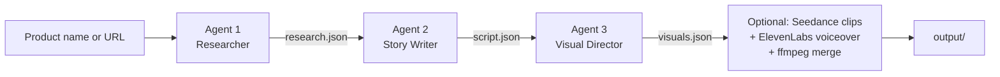

# Gossip Pipeline

[](https://github.com/stevenleon30/gossip-pipeline/actions/workflows/ci.yml)

Three Claude agents that turn any product into a ready-to-shoot TikTok storytime. One prompt in. A script, scene-by-scene visual direction, and (optionally) generated video clips with voiceover out.

I'm a QA engineer, not a full-time app developer. I built this AI-assisted as a curiosity project to see how far agent orchestration can go for content creation. I tested it the way I'd test any product, and the [limitations](#limitations) are listed honestly below.

## How it works



Each agent hands structured JSON to the next.

**Agent 1: Researcher.** Proposes three gossip-worthy angles for the product: drama, surprise, a hidden detail, or an "I can't believe this works" hook. It works from what the model already knows. It does not browse the web (see [limitations](#limitations)).

**Agent 2: Story Writer.** Writes the TikTok script in first-person gossip voice. Hook in 3 seconds, escalation, soft product reveal, a CTA that doesn't feel like a CTA. Casual phrasing like "literally" and "wait wait wait." An `#ad` disclosure is requested in the prompt and then enforced in code.

**Agent 3: Visual Director.** Turns the script into scene prompts for Seedance. Each scene has a duration, a visual description, and the exact voiceover text. UGC look, not cinematic: natural light, real bedrooms, no over-production.

**Optional step 4.** Calls Replicate's Seedance 1.0 Lite for each scene, generates a voiceover with ElevenLabs, and merges audio into video with ffmpeg. Off by default because it costs money.

## Sample output

From an earlier run on Sol de Janeiro Bum Bum Cream (Claude Sonnet 4.6):

- Gossip angle: "The scent is so powerful strangers confront you about it in public"
- Script lines: *"caramel? vanilla? the tears of angels?"* and *"you WILL be perceived"*
- 5 scene prompts targeting a natural-light UGC look, with emotional beats specified

The three Claude steps finished in under a minute in my runs. Video generation adds time depending on Replicate's queue. The pipeline now logs how long each step takes, so you can check for yourself.

## Quick start

Requires Node 20 or newer.

```bash
git clone https://github.com/stevenleon30/gossip-pipeline.git
cd gossip-pipeline
npm install
cp .env.example .env
```

Open `.env` and set `ANTHROPIC_API_KEY`. That's the only key you need for a dry run. Then:

```bash
npm run pipeline -- "Sol de Janeiro Brazilian Bum Bum Cream"
```

You can also pass a product URL, or set `PRODUCT_NAME` in `.env`.

By default this is a **dry run**. You get `research.json`, `script.json`, and `visuals.json` in `output/`. The clip and voiceover files are empty placeholders. Nothing is sent to Replicate or ElevenLabs.

### Generate real clips

Add `REPLICATE_API_TOKEN` (and `ELEVENLABS_API_KEY` for voiceover) to `.env`, then:

```bash
GENERATE_ASSETS=true npm run pipeline -- "Your product"
```

This calls paid APIs for every scene. If a clip or voiceover fails, the run still finishes and the problem is listed in the `warnings` field of the result.

## Configuration

| Variable | Required | What it does |
| --- | --- | --- |
| `ANTHROPIC_API_KEY` | Yes | Claude API key. |
| `ANTHROPIC_MODEL` | No | Claude model for all three agents. Default `claude-sonnet-5-5`. |
| `GENERATE_ASSETS` | No | `true` to generate clips and voiceovers. Default is a dry run. |
| `REPLICATE_API_TOKEN` | For clips | Replicate token for Seedance. |
| `VIDEO_MODEL` | No | Replicate model slug. Default `bytedance/seedance-1-lite`. |
| `ELEVENLABS_API_KEY` | For voiceover | Without it, voiceover files are empty and the audio merge is skipped. |
| `ELEVENLABS_VOICE_ID` | No | Voice to use. Has a default. |
| `PRODUCT_NAME` | No | Product used when none is passed on the command line. |
| `PORT` | No | HTTP server port. Default `3001`. |
| `CORS_ORIGIN` | No | Comma-separated allowed origins. Unset means any origin. |
| `API_AUTH_TOKEN` | No | If set, the HTTP endpoint requires `Authorization: Bearer <token>`. |

## Run it as an HTTP server

```bash
npm start
```

```bash
curl -X POST http://localhost:3001/api/generate \
  -H "Content-Type: application/json" \
  -H "Authorization: Bearer $API_AUTH_TOKEN" \
  -d '{"product": "Sol de Janeiro Brazilian Bum Bum Cream"}'
```

The response has `caption`, `script`, `clips`, `voiceovers`, and `warnings`. Clip and voiceover entries are URLs under `/output/`. `GET /health` reports whether a run is in progress.

The endpoint spends real money when `GENERATE_ASSETS=true`, so set `API_AUTH_TOKEN` and `CORS_ORIGIN` before exposing it anywhere. It accepts one run at a time and returns `429` if you send a second, because runs share one `output/` folder.

## Run it on GitHub Actions

The **Run gossip pipeline** workflow is manual (`workflow_dispatch`). Add `ANTHROPIC_API_KEY` (and the Replicate and ElevenLabs keys if you want assets) as repository secrets, then run it from the Actions tab. Results upload as the `pipeline-output` artifact, including after a failed run.

## Design notes

- **Structured output through forced tool use.** Each agent must answer by calling one tool whose input schema is the output shape. An earlier version asked for raw JSON and repaired quotes with regex. That was fragile.
- **Validation anyway.** A schema is a request, not a guarantee, so every response is checked at runtime (`src/validate.ts`). Bad output fails with the exact field path.
- **Disclosure enforced in code.** If the model forgets `#ad`, the caption and hashtags get it added. This is a safety net, not a compliance guarantee.
- **Dry run by default.** Nothing costs money until you opt in.
- **Failures are loud.** Failed assets are reported in `warnings` instead of silently producing empty files that look like success.

## Project layout

```
src/
  agents.ts     the three agents and the forced-tool-use helper
  validate.ts   output types and runtime validators
  video.ts      Seedance, ElevenLabs, download, ffmpeg merge
  index.ts      pipeline runner and CLI
  server.ts     Express API
  *.test.ts     tests
.github/workflows/
  ci.yml            typecheck and tests on every push and PR
  run-pipeline.yml  manual pipeline run
```

## Development

```bash
npm run typecheck
npm test
```

The tests cover the validators, the `#ad` guardrail, parsing of Replicate's different output shapes, and file downloads against a local server (including redirects and a 404). They run without any API keys.

## Limitations

- **The "research" is not live research.** Agent 1 is a single model call using the model's built-in knowledge. It has no web access, so it can't know what other creators are doing right now, and it can be wrong about the product. The prompt tells it to avoid inventing statistics or claims, but that is an instruction, not a check.
- **Review before you post.** The scripts are first-person testimonials written by a model. A human needs to check them for accuracy and for platform and advertising disclosure rules. The `#ad` guardrail only makes sure the tag is present.
- **Not everything is covered by automated tests.** The live calls to Claude, Seedance, and ElevenLabs are not tested in CI. Prompt quality is judged by reading the output.
- **Hosted video models change.** If Seedance generation starts failing, check the model's page on Replicate for a rename or retirement, then set `VIDEO_MODEL`.
- **Dry-run clips are empty files.** They exist so downstream code has paths to work with. Don't mistake them for video.
- **One run at a time.** All runs write to `output/`, with no per-run folders or queue.

## Ideas

- Give the researcher a web search tool so angles come from current sources
- Let the user pick the angle instead of always using the first
- Per-run output folders so runs can happen in parallel
- Stitch the scene clips into one video with the bundled ffmpeg
- A small live smoke test that runs on a schedule with a spending cap
